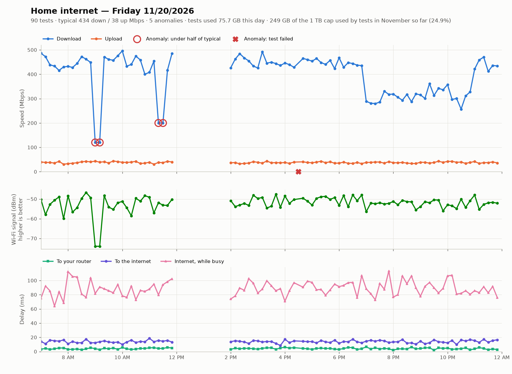

# wifi-blame-graph

**Is it your Wi-Fi or your internet provider?** A speed monitor for your Mac that tests your home connection all day and draws graphs that answer that question.



*Sample graph drawn from made-up data.*

## What it does

- Runs an [Ookla Speedtest](https://www.speedtest.net/apps/cli) on a schedule (by default every 10 minutes, 7:00 am to midnight) and logs every result to a CSV file. If Ookla refuses a test, it uses the speed tester built into macOS instead. You can also choose to use only one of the two.
- Alongside each test, records what you need to assign blame:
  - **Wi-Fi signal strength, interference, band and channel.** Is your laptop on a weak connection?
  - **Delay to your own router.** Is the slowdown inside your house?
  - **Delay to the internet, idle and while busy.** Is the lag at your provider?
  - **Provider name, public IP and test server.** Did something change upstream?
- Checks your connection every minute with a tiny test that uses almost no data, and records each outage: how long it lasted, and whether it was your **provider** (your router answered but the internet didn't) or your **Wi-Fi** (the router itself stopped answering).
- Draws a graph for each day, plus a rolling 7-day graph, as both a PNG and an interactive web page. Hover any point for every detail, or click it to open the speedtest.net result to send to your provider. Your plan's speed appears as a line, and outages show as shaded bands.
- Builds a **home page** with your speed by time of day across all days, and a printable **provider report** with typical speeds against your plan, worst times of day, outages and links to the bad tests, ready to save as a PDF.
- Highlights anomalies: any failed test, or any test under half of that day's typical speed.
- Doesn't blame the internet for things that aren't its fault:
  - It only tests on your home network.
  - It skips tests while your Mac is asleep, so closing the lid isn't logged as an outage.
  - It grays out tests taken on a VPN, in Low Power Mode, or while your Mac was already busy downloading something.
- Tracks how much data the tests use against your monthly data cap. It can also hold the tests to a daily data limit, or pause them for the rest of the month at a share of your cap.

Everything runs locally on macOS's built-in scheduler. There's no server, Docker or account to set up.

## ⚠️ Mind your data cap

Each speed test downloads and uploads real data, roughly your speed × 12 seconds in each direction. On a fast plan, the default schedule adds up quickly:

| Plan speed | Per test | Per full day (102 tests) |
|---|---|---|
| 100 Mbps | ~150 MB | ~15 GB |
| 500 Mbps | ~700 MB | ~70 GB |
| 1 Gbps | ~1.3 GB | ~130 GB |

If your plan has a cap:

- Set `data_cap_gb` so the graphs show how much the tests have used this month.
- Set `daily_data_limit_gb` to limit how much the tests can use in a day. A test that would go over the limit is skipped and logged as `data_limit`.
- Set `pause_at_percent_of_cap` (for example `25`) to stop testing for the rest of the month once the tests have used that share of your cap.
- Test less often (see [Schedule examples](#schedule-examples)).

`setup install` and `setup status` print an estimate of how much data your schedule will use, based on your latest test.

## ⚠️ Ookla's usage limit

Ookla's free Speedtest CLI is for personal, non-commercial use on a single computer, and Ookla limits how often it can be run. The limit isn't published. In practice, testing every 10 minutes all day triggered a temporary block of more than half an hour. By default (`speed_test_tool: "ookla_then_apple"`), a refused test is immediately rerun with Apple's built-in tester, so there's no gap. With `"ookla"` only, refused tests are logged as `rate_limited` (a gap on the graph, never an anomaly). **Test every 15–30 minutes or less often.** Every 5 minutes is allowed by the settings but is likely to be refused.

### Ookla or Apple's built-in tester?

| | Ookla Speedtest | Apple's `networkQuality` (built into macOS 12+) |
|---|---|---|
| Install | Homebrew, plus accepting Ookla's terms | Nothing, it's already on your Mac |
| Shareable result link | Yes (speedtest.net), widely recognized by providers | No |
| Test server | Nearest Ookla server (you can block bad ones) | Apple's own servers |
| Extra details | Jitter, packet loss, provider name, public IP | Delay while busy (how laggy calls get) |
| Usage limit | Yes, unpublished | None published |
| Data per test | Similar for both, since each maxes out your connection for ~10–30 seconds | |

The two measure a little differently, so results from Apple's tester are marked with a ◇ on the graphs and named in the hover details and the report.

## Requirements

- macOS 13 or later, on a Mac that connects over **Wi-Fi**
- [Homebrew](https://brew.sh)
- Python 3.10 or later (`brew install python`)

## Setup

You can do this yourself in about ten minutes, with no programming needed beyond pasting commands into Terminal. If you'd rather have an AI coding assistant do it, see [Setting up with an AI assistant](#setting-up-with-an-ai-assistant).

```sh
# 1. Install Ookla's speed test tool (skip if you'll use speed_test_tool: "apple")
brew tap teamookla/speedtest
brew install teamookla/speedtest/speedtest

# 2. Get the code and its Python packages
git clone https://github.com/Joey-Ruz/wifi-blame-graph.git
cd wifi-blame-graph
python3 -m venv .venv
.venv/bin/pip install -r requirements.txt

# 3. Read and accept Ookla's terms (required by Ookla; skip for "apple")
.venv/bin/python -m wifiblame.setup accept-ookla

# 4. While connected to your home Wi-Fi, remember your router as "home"
.venv/bin/python -m wifiblame.setup record-home

# 5. (Optional) change the schedule or data cap: see Settings below

# 6. Turn the schedule on
.venv/bin/python -m wifiblame.setup install
.venv/bin/python -m wifiblame.setup status
```

The first time a test runs, macOS asks whether Python may "find devices on your local network". Click **Allow**, because the monitor needs it to measure the delay to your router. You can change this later in System Settings → Privacy & Security → Local Network.

On an Apple-chip Mac, if Homebrew says "Cannot install under Rosetta 2", your terminal is running in Intel mode. Prefix the brew command with `arch -arm64`.

## Setting up with an AI assistant

An AI coding assistant that can run Terminal commands on your Mac (Claude Code, for example) can do the setup for you. Ask it to "set up wifi-blame-graph by following its README". Two steps must be done by you:

1. **Accepting Ookla's terms** (only if you use Ookla). `setup accept-ookla` asks you to type `yes`. That's your agreement with Ookla, so read the linked terms and type it yourself. An assistant shouldn't accept for you. To skip Ookla entirely, set `speed_test_tool` to `"apple"`.
2. **Allowing local network access.** When the first test runs, click **Allow** on macOS's "find devices on your local network" prompt.

The assistant should also confirm with you which Wi-Fi network is home before running `record-home`, and ask how often to test and what your data cap is before running `setup install`.

## Using it

| To | Run |
|---|---|
| Test once, right now | `.venv/bin/python -m wifiblame.runner` |
| Draw graphs, the report and the home page | `.venv/bin/python -m wifiblame.graphs` |
| Make a provider report for any dates | `.venv/bin/python -m wifiblame.report 2026-11-01 2026-11-21` |
| Draw graphs for one day | `.venv/bin/python -m wifiblame.graphs 2026-11-20` |
| Check the schedule | `.venv/bin/python -m wifiblame.setup status` |
| Turn the schedule off | `.venv/bin/python -m wifiblame.setup remove` |

Graphs, the 7-day report and the home page are also redrawn automatically every night at 11:59 pm. If your Mac was asleep then, they're redrawn the next time it wakes. Start at `graphs/index.html`.

| File | What's in it |
|---|---|
| `graphs/index.html` | Home page: speed by time of day, every day's graphs, the report |
| `graphs/report/last-7-days.html` | Provider report (open it and Print → Save as PDF) |
| `data/speed_log.csv` | One line per scheduled run |
| `data/outage_log.csv` | One line per minute check |
| `graphs/daily/YYYY-MM-DD.png` / `.html` | One day |
| `graphs/week/last-7-days.png` / `.html` | The last seven days |
| `data/schedule.log` | What the scheduler printed, useful if something isn't running |

## Settings

Settings live in `config.json` (start from `config.example.json`). Anything you leave out uses its default. After changing the schedule, run `setup install` again; it prints the new data estimate.

| Setting | Default | Meaning |
|---|---|---|
| `first_hour` | `7` | First hour of the day to test (0–23) |
| `last_hour` | `23` | Last hour to test; tests run through the end of this hour |
| `minutes_between_tests` | `10` | 5, 10, 15, 20, 30, 60 (hourly), 120, 180, 240, 360, 480, 720, or 1440 (once a day) |
| `data_cap_gb` | `null` | Your plan's monthly cap in GB, or `null` for none |
| `daily_data_limit_gb` | `null` | Most data the tests may use per day; a test that would go over is skipped |
| `pause_at_percent_of_cap` | `null` | Stop testing for the rest of the month once the tests have used this % of `data_cap_gb` |
| `background_limit_mbps` | `5` | If your Mac is already downloading faster than this, the test is marked unreliable |
| `speedtest_path` | `null` | Path to Ookla's tool, if Homebrew didn't put it in the usual place |
| `plan_download_mbps` | `null` | The download speed you pay for; drawn as a line and used for "% of plan" |
| `plan_upload_mbps` | `null` | The upload speed you pay for |
| `speed_test_tool` | `"ookla_then_apple"` | `"ookla_then_apple"` (Ookla, with Apple's tester when Ookla refuses), `"ookla"`, or `"apple"` (no Ookla install or terms needed) |
| `blocked_servers` | `[]` | Test servers to avoid, by name (as shown in your results) or id; tests use the nearest server not on the list |
| `home_router_macs` | `[]` | Filled in by `record-home`; run it again on a new router |
| `ookla_terms_accepted` | `false` | Set by `accept-ookla` |

### Schedule examples

| You want | `minutes_between_tests` | `first_hour` | `last_hour` | Tests a day |
|---|---|---|---|---|
| Every 5 minutes (likely refused by Ookla) | `5` | `7` | `23` | 204 |
| Every 10 minutes (default) | `10` | `7` | `23` | 102 |
| Every 30 minutes | `30` | `7` | `23` | 34 |
| Once an hour | `60` | `7` | `23` | 17 |
| Every 6 hours: 7 am, 1 pm, 7 pm | `360` | `7` | `23` | 3 |
| Once a day at noon | `1440` | `12` | `12` | 1 |

Gaps longer than an hour count from `first_hour`, and the last test is the last one that fits before the end of `last_hour`.

## How results are judged

| Status | Meaning | On the graph |
|---|---|---|
| `ok` | Test finished | A point on each line |
| `failed` | The Mac was awake, but the test couldn't finish | ❌ at the bottom, counted as an anomaly |
| `asleep` | The Mac was asleep or dozed off mid-test | Gap; never an anomaly |
| `not_home` | Connected to a network that isn't yours | Gap |
| `no_network` | Wi-Fi not connected | Gap |
| `data_limit` | Skipped to stay within your data limit | Gap |
| `rate_limited` | Ookla refused the test because of its usage limit (only with `"ookla"`) | Gap; never an anomaly |

- **Typical speed** is the median of that day's successful, reliable tests, with download and upload judged separately. **It needs at least three reliable tests in a day.** On a day with fewer, such as with an hourly-or-slower schedule, a day mostly away from home, or a day cut short by a data limit, each test is compared with the typical speed of the **last 7 days** instead. That also needs three tests, so a once-a-day schedule starts flagging slow tests on its third day. Failed tests are always flagged.
- **Anomaly:** a failed test, or a reliable test under half of the typical speed.
- **Unreliable:** VPN on, Low Power Mode on, or your Mac already downloading over `background_limit_mbps`. These tests are shown in gray and left out of the typical speed.

**Outages:** a connection check runs every minute during test hours, pinging your router and two well-known internet addresses (1.1.1.1 and 8.8.8.8). Three missed checks in a row make an outage. If your router answered but the internet didn't, it's a **provider** outage. If the router didn't answer either, or Wi-Fi dropped right after you were home, it's a **Wi-Fi** outage. Checks are skipped while the Mac is asleep or away from home.

**Reading the graph:**
- Slow speed while the router delay stays low and the signal stays strong points to your provider.
- Slow speed alongside a weak signal or high router delay points to your Wi-Fi.

## Limits

- macOS only.
- Wi-Fi only. The home check and signal readings come from the Wi-Fi connection.
- Speeds are measured from wherever your Mac is. A laptop in a far room measures that room's Wi-Fi.
- Wi-Fi itself usually tops out below your plan's speed on fast plans. A "1 Gig" plan often measures 600–850 Mbps over Wi-Fi even when the provider is delivering in full. To check, test once over an Ethernet cable.

## Development

```sh
.venv/bin/python -m pytest
```

The tests never touch the network: every macOS tool call has a parser that's tested against saved output.

## Not affiliated with Ookla

This project uses Ookla's free Speedtest CLI and is not affiliated with or endorsed by Ookla. By using it, you agree to Ookla's [EULA](https://www.speedtest.net/about/eula), [terms](https://www.speedtest.net/about/terms) and [privacy policy](https://www.speedtest.net/about/privacy).

## License

[MIT](LICENSE)
